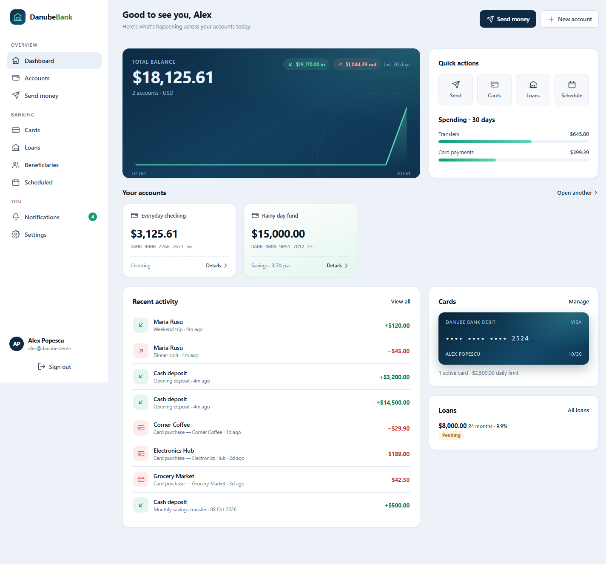
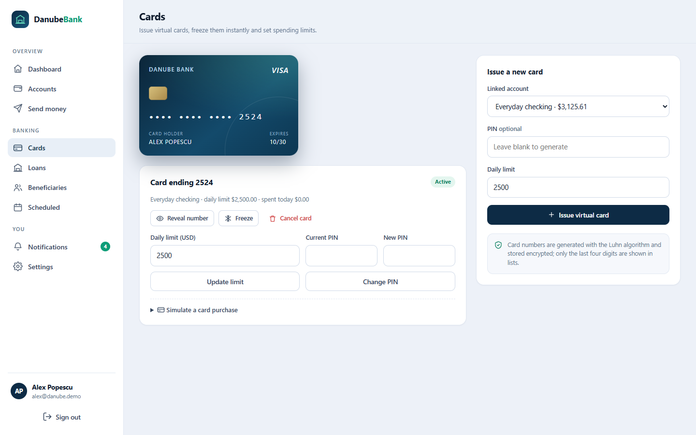
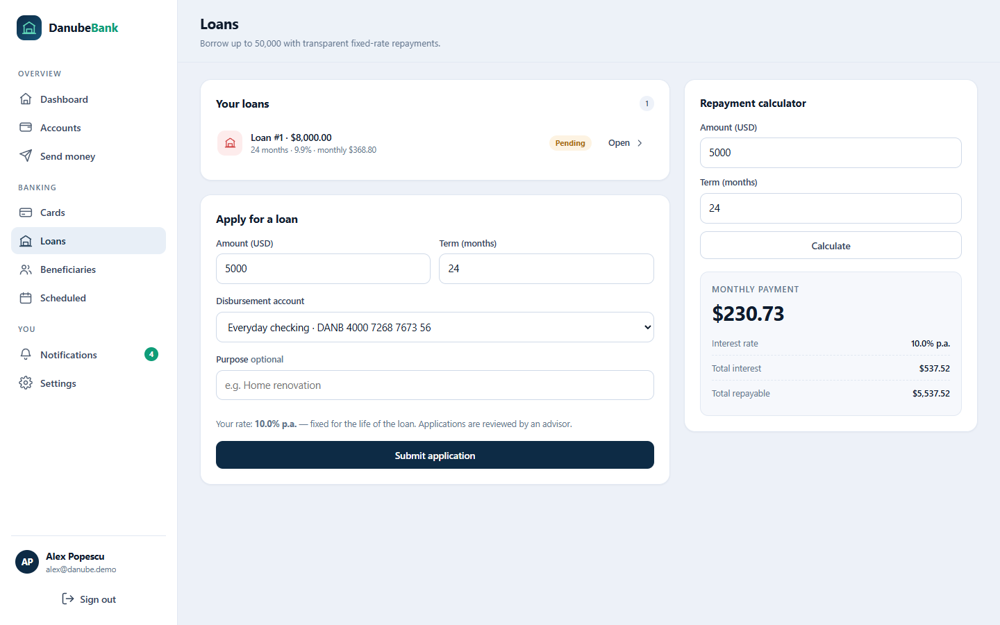
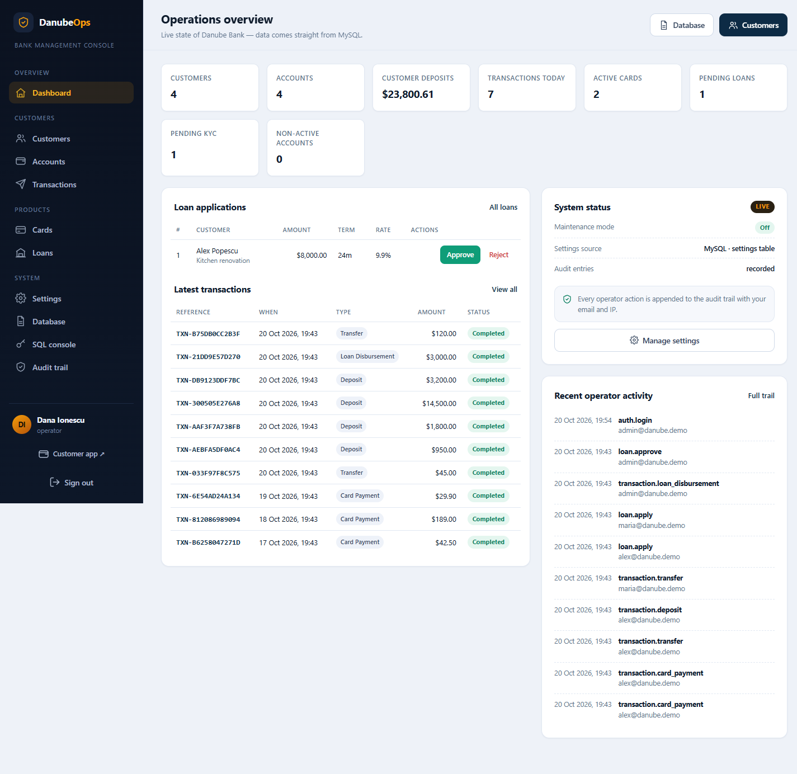
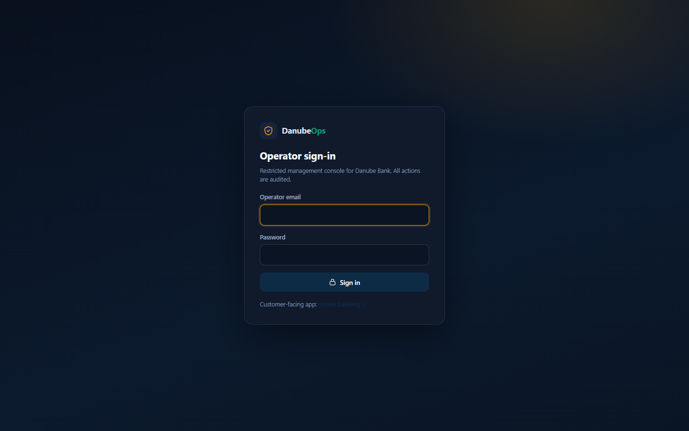

# Danube Bank — open-source banking system demo

**A complete, runnable banking platform with a customer app, a separate operator console and MySQL — built for learning, demos and as a base for real projects.**

[](LICENSE)
[](https://www.python.org/)
[](https://fastapi.tiangolo.com/)
[](https://www.mysql.com/)
[](tests/)
[](https://bankingsystem.danubelabs.net/)

[**Live project site & documentation →**](https://bankingsystem.danubelabs.net/)



---

## What is this?

Danube Bank is a full banking system demo that runs entirely on your machine:

- **Customer app** — online banking at `http://127.0.0.1:8000`
- **Danube Ops** — a standalone operator console at `http://127.0.0.1:8001`
- **MySQL 8.4** — the single source of truth, started with Docker

Every screen and button is backed by real functionality: there are no mock APIs, fake charts or
disabled controls. Balances live in a double-entry ledger, transfers are row-locked inside a database
transaction, card numbers are encrypted, and operators can manage the database itself.

> This started as a five-file console exercise ([preserved in `legacy/`](legacy/)) and grew into a
> complete two-application system.

---

## Feature tour

### Customer banking

| Area | What works |
| --- | --- |
| Onboarding | Register, sign in, profile & password settings, KYC status, notifications |
| Accounts | Multiple checking/savings accounts, overdraft, savings interest, statements, CSV export |
| Payments | Instant local transfers, saved beneficiaries, printable receipts, standing orders |
| Cards | Virtual Visa cards with Luhn-valid numbers, encrypted PANs, hashed PINs, freeze/cancel, daily limits, purchases |
| Loans | Live quotes, applications, amortisation schedules, instalment and early repayment |
| Insights | 14-day balance chart, 30-day inflow/outflow, spending breakdown |

### Operator console (Danube Ops)

| Area | What works |
| --- | --- |
| Customers | Create, edit, lock/unlock, change roles, reset passwords, KYC decisions |
| Accounts | Open, freeze, close, post audited credit/debit adjustments |
| Transactions | Search the ledger, inspect entries, reverse with a reason |
| Cards | Issue, reveal (audited), freeze, cancel, limits, reset PIN |
| Loans | Approve, reject, book and disburse on behalf of a customer |
| Settings | Edit every business rule live — no redeploy |
| Database | Browse tables, CSV export, SQL console, full SQL backup |
| Audit | Searchable trail of every operator action with IP address |

### Screenshots

| Customer dashboard | Cards | Loans |
| --- | --- | --- |
|  |  |  |

| Operator overview | Operator sign-in |
| --- | --- |
|  |  |

---

## Quick start

**Requirements:** Docker Desktop and Python 3.11+.

```bash
git clone https://github.com/FiredMosquito831/simple-banking-system.git
cd simple-banking-system

# 1 — MySQL 8.4
docker compose up -d

# 2 — Python environment
python -m venv .venv
.venv\Scripts\activate          # Windows
# source .venv/bin/activate     # macOS / Linux
pip install -r requirements.txt

# 3 — Configuration, schema and demo data
cp .env.example .env
python -m scripts.seed

# 4 — Run both apps
uvicorn app.main:app --reload            # customers  → :8000
uvicorn admin_app.main:app --port 8001   # operators  → :8001
```

Open **http://127.0.0.1:8000** and **http://127.0.0.1:8001**.

### Demo accounts

| Email | Password | Role |
| --- | --- | --- |
| `alex@danube.demo` | `Password123!` | Customer (2 accounts, card, pending loan) |
| `maria@danube.demo` | `Password123!` | Customer (KYC pending, active loan) |
| `andrei@danube.demo` | `Password123!` | Customer (transfer target) |
| `admin@danube.demo` | `Password123!` | Operator (both apps) |

Reset at any time: `python -m scripts.seed --reset`.

### Run everything in Docker

```bash
docker compose --profile full up -d --build
```

This starts MySQL, seeds the database, and runs both apps on ports 8000/8001.

---

## Architecture

```
┌─────────────────────┐        ┌─────────────────────┐
│  Customer app :8000 │        │  Danube Ops :8001   │
│  FastAPI + Jinja2   │        │  FastAPI + Jinja2   │
└──────────┬──────────┘        └──────────┬──────────┘
           │                              │
           └──────────┬───────────────────┘
                      ▼
         app/services/banking.py  ← single money-movement layer
         app/services/settings.py ← cached runtime configuration
                      ▼
           SQLAlchemy 2.0  →  MySQL 8.4 (21 tables)
```

The operator app never edits balances directly. Adjustments, reversals and disbursements all call the
same `post_transaction()` used by the customer app, so ledger invariants hold regardless of which app
initiates a change.

### The ledger

Money is stored in integer cents. Every movement writes a `Transaction` plus one signed
`LedgerEntry` per account, including the running balance:

```
Transaction  TXN-8F2A…   transfer   250.00 USD
 ├─ LedgerEntry  account A   −25000   balance_after 175000
 └─ LedgerEntry  account B   +25000   balance_after  25000
```

- Accounts are locked with `SELECT … FOR UPDATE`, ordered by id to avoid deadlocks.
- Account status, currency and available funds (balance + overdraft) are validated before writing.
- Multi-entry transactions must sum to zero; single-sided entries represent the bank's external side.
- Idempotency keys are unique, so retried requests cannot double-charge.
- Reversals post the mirror entries and mark the original `reversed` — nothing is deleted.

---

## Configuration

### Environment (`.env`)

| Variable | Purpose |
| --- | --- |
| `SECRET_KEY` | Signs session cookies and derives the card-encryption key |
| `DATABASE_URL` | SQLAlchemy URL (defaults to local MySQL) |
| `DEMO_PASSWORD` | Password for seeded users |
| `ALLOW_ADMIN_SQL_WRITE` | `1` enables INSERT/UPDATE/DELETE in the operator SQL console |

### Runtime settings (MySQL)

Business rules are **rows in the `settings` table**, editable from Danube Ops → Settings:

institution name, support email, default currency, transfer/cash limits, account limits, opening credit,
overdraft, savings interest, card limits, loan bounds, loan pricing, maintenance mode and demo-login
visibility. Both apps refresh their cache every 10 seconds; every change is audited.

---

## Project layout

```
app/                    customer application
  main.py               entrypoint, maintenance gate, error handling
  models.py             customers, accounts, cards, ledger, loans, settings, audit
  security.py           scrypt hashing, Luhn, Fernet-encrypted PANs
  routers/              auth, accounts, transfers, cards, loans, admin
  services/banking.py   the only code that moves money
  services/settings.py  DB-backed settings with cache
  services/queries.py   dashboards, statements, searches
  templates/ static/
admin_app/              operator application (port 8001)
  main.py auth.py views.py banking_ops.py system.py
  templates/ static/
docs/                   GitHub Pages site and documentation
scripts/seed.py         schema, settings defaults, demo data
tests/                  unit + ledger integration tests
legacy/                 original CLI scripts, preserved
docker-compose.yml      MySQL (+ optional full-stack profile)
Dockerfile              image shared by both apps
```

---

## HTTP surface

Both apps are server-rendered, with JSON only for health, card reveal and a few checks.

| App | Route groups |
| --- | --- |
| Customer `:8000` | `/login`, `/register`, `/dashboard`, `/accounts/*`, `/transfer`, `/receipt/*`, `/beneficiaries`, `/scheduled`, `/cards`, `/loans`, `/notifications`, `/settings`, `/admin/*`, `/health`, `/api/docs` |
| Operator `:8001` | `/login`, `/customers/*`, `/accounts/*`, `/transactions/*`, `/cards`, `/loans`, `/settings`, `/database/*`, `/sql`, `/audit`, `/health` |

---

## Testing

```bash
pytest
```

14 tests cover Luhn generation, scrypt hashing, annuity maths, money formatting, balanced entries,
overdrafts, ownership checks, idempotency and deposit/withdrawal entries. Ledger tests run against
MySQL and roll back their data; they skip automatically if the database is unavailable.

---

## Security notes

- scrypt password/PIN hashing with per-secret salts and constant-time comparison.
- Card PANs encrypted with Fernet; only the last four digits are stored in clear.
- CSRF token on every mutating form; ownership checked server-side on every route.
- Separate session cookie and signing key for the operator app.
- Audited SQL console with destructive statements blocked by default.

**This is a demo, not a bank.** There is no TLS termination, MFA, real KYC provider or card network
connectivity, and no money moves. Do not use it to handle real funds.

---

## Documentation

Full installation, architecture, ledger design, operations guide, database tooling and deployment
notes live at **[bankingsystem.danubelabs.net](https://bankingsystem.danubelabs.net/)** and in
[`docs/`](docs/).

## License

MIT — see [LICENSE](LICENSE). Built by [Danube Labs](https://danubelabs.net).
